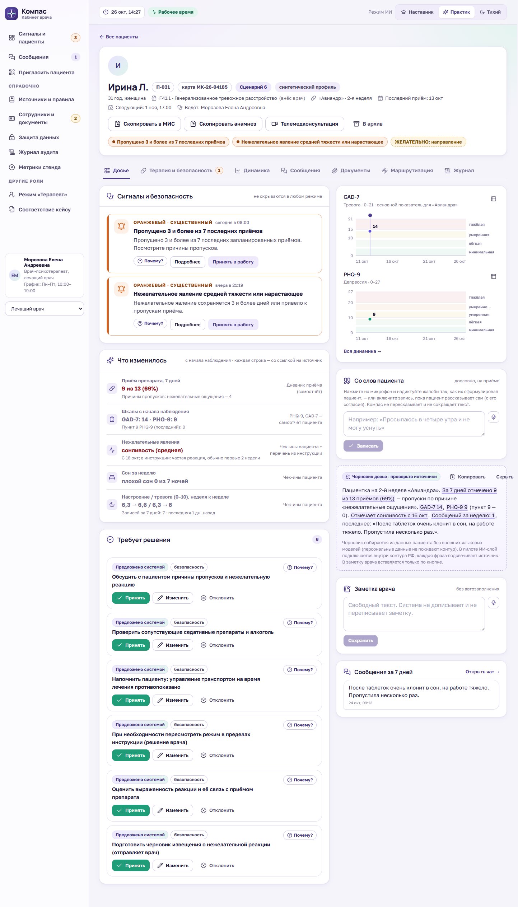
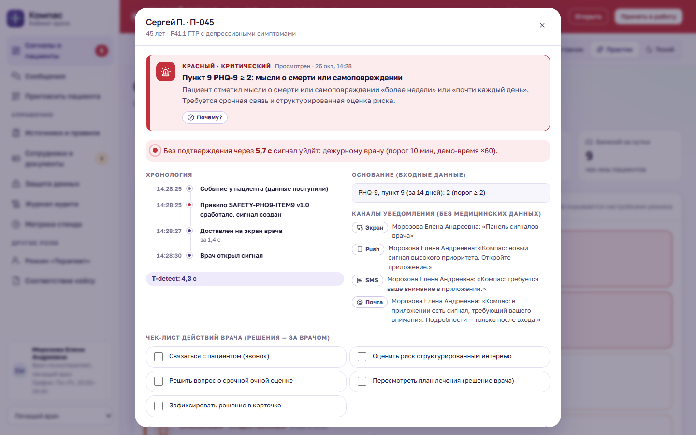
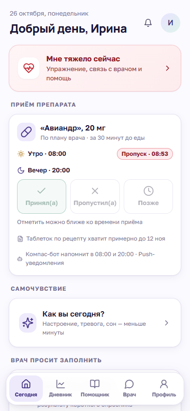
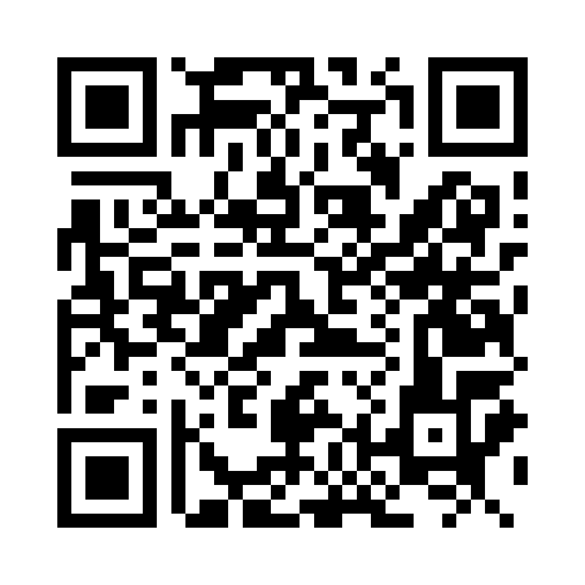

# Компас — цифровой ассистент врача и пациента

Прототип для кейс-чемпионата **«Клинический компас»**: инструмент поддержки врачебных решений при ведении
взрослых пациентов с тревожной и депрессивной симптоматикой. Демонстрируется на клинических сценариях с препаратом
**«Авиандр»** (маритупирдин).

> **Врач решает. Компас помнит, считает, проверяет и вовремя зовёт.**

Пациент между визитами за минуту отмечает самочувствие и приём препарата. Компас считает шкалы, проверяет правила
безопасности по клиническим рекомендациям и инструкции, а врач получает досье на 30 секунд и сигналы — и принимает
решения сам. Система ничего не назначает, не отменяет и никуда не направляет без подтверждения врача.

**Демо: https://olgasalnik.github.io/kompas/** — открывается в браузере, ничего устанавливать не нужно ·
код: [github.com/olgasalnik/kompas](https://github.com/olgasalnik/kompas) · [QR-код](#qr-код-на-демо) · данные
синтетические.

### Быстрый старт

| Как | Что сделать |
|---|---|
| **Открыть онлайн** | Ссылка выше. Лучше всего в Chrome или Edge: там работают и голосовой ввод, и голосовые сообщения |
| **Запустить у себя (Windows)** | Установить [Node.js](https://nodejs.org/) (LTS) → двойной щелчок по `start-windows.bat` |
| **Запустить у себя (macOS, Linux)** | Установить Node.js → в терминале `sh start-mac-linux.sh` |
| **Без интернета и установки** | `npm run build:offline` → файл `offline/index.html` открывается двойным щелчком (без распознавания сканов) |

Первый запуск ставит зависимости (1–3 минуты) и сам открывает сайт на `http://localhost:5180`. Для показа «пациент →
врач» откройте сайт в двух вкладках: в одной — «Я пациент», в другой — «Я врач».

| Кабинет врача | Красный сигнал | Кабинет пациента |
|---|---|---|
|  |  |  |

## Что умеет — 8 задач кейса

| № | Задача кейса | Как сделано в прототипе |
|---|---|---|
| 1 | Стандартизированная оценка | PHQ-4, PHQ-9, GAD-7 у пациента (по вопросу на экран), автоподсчёт по ключу, отдельная обработка пункта 9; ввод HAM-D / HAM-A / MADRS врачом |
| 2 | Справка по терапии | Паспорт «Авиандра» по инструкции из ГРЛС, проверка показаний, метка **«ВНЕ ИНСТРУКЦИИ — решение врача»**, карточки КР Минздрава |
| 3 | Риски и нежелательные явления | Правила **СТОП** (противопоказания) и **ВНИМАНИЕ** (взаимодействия, «с осторожностью»), чек-лист факторов, журнал НЯ, черновик извещения |
| 4 | Мониторинг динамики | Досье на 30 секунд: «что изменилось», графики шкал с градациями и отметками событий, симулятор 6 недель |
| 5 | Самоотчёт пациента | Чек-ин ≤ 60 с и ≤ 5 нажатий (замеряется), отметка приёма, свои графики, «Мне тяжело сейчас» |
| 6 | Каналы связи | Чат с карточкой контекста за 7 дней, автоответы только по инструкции с источником, честные часы ответа, уведомления без медданных |
| 7 | Приверженность | Принял / Пропустил / Позже, причины пропусков, индекс за 7 и 28 дней, T-detect |
| 8 | Направление к психиатру | Режим «Терапевт»: PHQ-4 → «что исключить» → шкалы → красные флаги → **ОБЯЗАТЕЛЬНО** / **ЖЕЛАТЕЛЬНО** со сроком и источником |

Сквозное: **алертинг** трёх уровней (красный — безопасный экран пациенту, push + SMS + экран врачу, чек-лист,
эскалация 10 / 30 мин на дежурного и заведующую, журнал с временем каждого шага), кнопка **«Почему?»** у каждого
вывода (правило, версия, входные данные, источник), реестр источников, согласия по целям, журнал аудита, режимы ИИ
«Наставник / Практик / Тихий». Полная таблица 8 функций, 10 условий и 13 метрик — на странице «Соответствие кейсу».

### Для врача и пациента в работе

- **Вход «Я врач» / «Я пациент»**: роли разделены с главной страницы и экрана входа.
- **Врачи — с ФИО полностью, графиком работы и документами** (образование, аккредитация, проверка в ФРМР — данные
  синтетические). Срок ответа пациенту считается по графику *его* врача: «ответит в понедельник в 10:00».
- **Сообщения**: входящие у врача со статусами «Новое / Просмотрено, ждёт ответа / Отвечено»; пациент видит
  «просмотрено врачом» и «врач ответил»; уведомления пациенту (push, SMS, почта) без медицинских данных.
- **Перед приёмом**: пациент заполняет «К приёму» (что беспокоит, что изменилось, вопросы), врач видит
  «Ближайшие приёмы» с готовым превью по каждому и кнопкой «Копировать».
- **Информированное добровольное согласие** по целям, право отказа (ст. 20 323-ФЗ, ст. 12 и 29 Закона № 3185-1),
  доверенное лицо — родственник, опекун или законный представитель: кому и что приходит, выбирает пациент.
- **Экстренная ситуация простыми словами** и раздел «Куда обратиться» (112, 103, телефон доверия, ПНД, НМИЦ
  им. Сербского, кризисные центры — региональные контакты добавляет клиника).
- **Архив пациентов**, номер медицинской карты, дата последнего приёма, **поиск по всей истории** (заметки,
  сообщения, документы, «к приёму»), включая архив.
- **Прикреплённые документы** (анализы, выписки, фото) у пациента и врача; **телемедицинская консультация**
  «врач — врач» и «врач — пациент» (приказ № 965н) с автоматически собранными жалобами и анамнезом.
- **Распознавание текста со сканов и фото** — прямо в браузере (tesseract.js, русский + английский), изображение
  никуда не отправляется. Врач видит скан рядом с текстом, слова с низкой уверенностью подчёркнуты; Компас находит
  в тексте препараты из групп взаимодействия «Авиандра», коды МКБ-10 и даты, сверяет код с карточкой. В карточку
  попадает только проверенная врачом печатная версия — дальше она в поиске и в запросе телемедконсультации.
- **Голосовой ввод** (Web Speech API браузера): пациент надиктовывает сообщение врачу, заметку в дневнике, «К приёму»,
  вопрос помощнику; врач — ответ, заметку и **«Со слов пациента»** — дословную запись жалоб на приёме, которая
  попадает в черновик досье, поиск и телемедконсультацию. Надиктованные сообщения помечены «голосом».
- **Обоснование выбора «Авиандра»** по показаниям, профилю симптомов и противопоказаниям; дозировка в мг и г,
  разовая и суточная. Расшифровка плохого сна в ежедневной записи.
- **Рецепт для записи врача** по образцу справочника: `Rp.: Tab. Maritupirdini 0,02 № 60` /
  `D.S. Внутрь, по 1 таблетке 2 раза в сутки (утром и вечером), за 30 минут до еды.`, бланк № 107-1/у. Количество
  кратно упаковке (30 таблеток) с расчётом «на сколько дней хватит», запас по всем выписанным рецептам; пациент видит
  «таблеток хватит до …» и за 5 дней до конца — кнопку «Попросить рецепт».
- **Голосовые сообщения** у пациента и врача: запись до 1 минуты (MediaRecorder), прослушивание в переписке,
  автоматическая расшифровка рядом. Кризисная фраза голосом даёт тот же красный сигнал, что и текстом; голосовое без
  расшифровки не получает автоответа — врач его прослушивает.
- **Компас-бот** (раздел «Помощник»): напоминания о приёме в 08:00 и 20:00 в выбранный канал (push, SMS, почта, MAX,
  Telegram) без названия препарата, ответ «Принял(а) / Позже / Пропустил(а)» в одно нажатие, повтор через 30 минут после
  «Позже»; поддержка по утверждаемым шаблонам (неделя без пропусков, пропуск без упрёков, трудный день → упражнение,
  первые две недели). Пока открыт красный сигнал, бот молчит.
- **Шифрование**: данные стенда (карточки, переписка, голосовые, сканы) хранятся в браузере в виде шифротекста
  AES-GCM 256 со сжатием, ключ неизвлекаемый (Web Crypto, IndexedDB); вкладки синхронизируются в памяти. Страница
  **«Защита данных»**: живая проверка хранилища, что и куда уходит наружу, врачебная тайна и закон, что меняется в пилоте.
- **Документы специалистов**: диплом, аккредитация со сроком, запись в ФРМР; статусы «проверено / истекает (за 90 дней) /
  истекла / на проверке / не найден», страница «Сотрудники и документы» и «Проверить в реестре» (имитация).
- **«Скопировать анамнез»** одной кнопкой в структуре медицинской записи и **«Проверить совместимость»** любого лекарства
  (МНН или торговое название) с «Авиандром» — у врача и у пациента.
- **Справка о препарате для врача**: фармакологическая группа, механизм, фармакокинетика (T½, CYP2D6), нежелательные
  реакции по системам органов, передозировка, форма выпуска — с источником у каждого блока и открытой пометкой
  о расхождении источников.
- Раздел **«Правовые основания»** на странице «Соответствие кейсу».

## 7 демонстрационных сценариев

1. **Классическое ГТР** — показание совпадает, предложение режима «Предложено» до подписи врача.
2. **Депрессия доминирует** — «вне инструкции», препарат не предлагается автоматически.
3. **Сочетанный приём** (сертралин + дифенгидрамин от простуды) — ВНИМАНИЕ и оранжевый сигнал.
4. **Беременность** — СТОП, обычный путь назначения заблокирован, ОБЯЗАТЕЛЬНО к психиатру и акушеру-гинекологу.
5. **Красный алерт** — пункт 9 PHQ-9 = 2 и «не вижу смысла»: безопасный экран, уведомление, эскалация.
6. **Пропуски и сонливость** — индекс приверженности, причины, предложения врачу.
7. **Терапевт** — тревога и телесные жалобы: скрининг и маршрут ЖЕЛАТЕЛЬНО / ОБЯЗАТЕЛЬНО.

Эталонные результаты каждого сценария проверяются автоматически — на странице «Демо-сценарии» и в автотестах.

## Запуск

Нужен [Node.js](https://nodejs.org/) 20 или новее.

```bash
npm install
npm run dev
```

Откройте <http://localhost:5180>. Остальные команды:

| Команда | Что делает |
|---|---|
| `npm test` | 120 автотестов: подсчёт шкал, все правила (положительный, отрицательный, граничный случай), алерты, эскалация, 7 сценариев, график врача, дозировки, архив, поиск, доверенное лицо, разбор распознанного текста, голосовой ввод, рецепт и запас таблеток, сверка паспорта препарата со справочником, бот, голосовые, шифрование, документы специалистов, анамнез, совместимость |
| `npm run build` | Сборка сайта в `dist/` (для GitHub Pages) вместе с моделями распознавания `dist/ocr/` (~13 МБ) |
| `npm run build:offline` | **Один файл** `offline/index.html` — открывается двойным щелчком без интернета и сервера (запасной вариант на защите; без распознавания текста, чтобы файл оставался лёгким) |
| `npm run build:share` | Офлайн-файл + страница для публикации по ссылке (тестовая копия) и папка `ocr/` рядом с ней |
| `npm run shots` | Скриншоты 35 ключевых экранов в `docs/screens/` через установленный Edge (нужен запущенный `npm run dev`); ещё 3 кадра — из `check:recognition` |
| `npm run qr` | QR-код на демо в `docs/qr/`: SVG для постера, PNG для слайдов, карточка с подписью (`-- --url=…` — другая ссылка) |
| `npm run story` | Рассказ «Как сделан проект» (≈27 страниц A4) в `docs/Компас_как_сделан_проект.pdf` из `docs/story/story.html`; иллюстрации — `npm run story:images` |
| `npm run summary` | Сводка проекта на 2 страницы A4 в `docs/Компас_сводка_проекта.pdf` (из `docs/summary/summary.html`) |
| `npm run check:recognition` | 27 проверок в настоящем браузере (Edge с имитацией микрофона): скан → текст → поиск; диктовка; голосовые сообщения; бот; совместимость; анамнез в буфере обмена; проверка дипломов; на диске нет открытых медданных; фото с телефона → сжатие → распознавание → после перезагрузки на месте (`-- --shots=docs/screens` добавляет кадры 34–36 и 39–43) |

Перед `dev` и `build` скрипт `scripts/copy-ocr.mjs` сам кладёт модуль распознавания и языковые модели из
`node_modules` в `public/ocr/` (папка в `.gitignore`) — внешние CDN не нужны.

## Как показывать

- Откройте **кабинет врача** в одном окне и **кабинет пациента** в другом (или на телефоне в той же сети: адрес
  `Network` из вывода `npm run dev`). Всё, что вводит пациент, мгновенно появляется у врача; время доставки сигнала
  измеряется.
- Кнопка **«Демо»** в правом нижнем углу: красный сигнал сценария 5 одной кнопкой, перемотка времени (+7 дней,
  +6 недель), ускорение эскалации (1 с = 1 мин), сброс стенда.
- Страница **«Демо-сценарии»** — 7 сценариев с эталонными проверками и сценарием показа на 7 минут.
- Страница **«Метрики стенда»** — замеры доставки сигнала, проверки правил, открытия досье, чек-ина; нагрузочный
  прогон движка; автопроверка уведомлений на утечку медицинских данных.

## Архитектура

```
src/
  core/        клиническое ядро без интерфейса: типы, движок правил, шкалы, приверженность, факты, текст
  data/        ПРАВИЛА КАК ДАННЫЕ (JSON):
    scales.json        шкалы: пункты, ключ подсчёта, градации, источник валидации
    packs/aviandr.json паспорт препарата: показания, СТОП, ВНИМАНИЕ, режим, НЯ, ответы пациенту
    alertRules.json    17 правил сигналов (красный / оранжевый / жёлтый) + словарь кризисных фраз
    routingRules.json  критерии ОБЯЗАТЕЛЬНО / ЖЕЛАТЕЛЬНО, красные флаги, «что исключить»
    sources.json       реестр источников S1–S13 (КР, ГРЛС, шкалы, законы)
    guidelines.json    карточки клинических рекомендаций
  store/       «сервер» стенда: данные, синхронизация вкладок, API действий, сценарии, генератор синтетики
  patient/     кабинет пациента (мобильный формат)
  doctor/      кабинет врача: сигналы, досье, терапия, динамика, сообщения, маршрутизация, журнал
  therapist/   режим «Терапевт»
  pages/       главная, демо-сценарии, соответствие кейсу
  ui/          общие компоненты: сигналы, «Почему?», графики, окна
```

- **Детерминированное ядро.** Подсчёт шкал, противопоказания, взаимодействия, сигналы и маршрутизация — правила с
  `rule_id`, версией и источником. Движок исполняет только утверждённые версии; каждое срабатывание хранит входные
  факты — это основа кнопки «Почему?».
- **Новый препарат = новый пакет** в `src/data/packs/` без изменения ядра. Так же добавляются шкалы и пороги.
- **Распознавание на стороне врача.** Сканы распознаются в браузере (`src/ui/ocr.ts`, модели в `ocr/` рядом с сайтом,
  грузятся только по кнопке); разбор текста — чистые функции `src/core/ocrText.ts`. Голосовой ввод — `src/ui/Dictate.tsx`:
  если браузер умеет распознавать русскую речь на устройстве, используется этот режим, иначе (Chrome, Edge) — облачный
  сервис браузера, о чём сказано в подсказке. В пилоте — сервер распознавания речи внутри контура РФ.
- **Без внешних языковых моделей.** Черновик досье собирается из данных пациента; ответы пациенту — только из
  утверждённого корпуса инструкции, иначе «передам врачу». Кризисные формулировки не «обсуждаются»: безопасный
  шаблон и красный сигнал.
- **Стенд в браузере.** В прототипе данные хранятся в IndexedDB браузера в зашифрованном виде (`src/store/vault.ts`:
  AES-GCM 256, неизвлекаемый ключ; хранилище вмещает сотни МБ — фото документов и голосовые помещаются, фото с телефона
  при загрузке уменьшаются до 2000 px), изменения расходятся по вкладкам через `BroadcastChannel` в памяти;
  таймеры эскалации и напоминания бота (`src/core/bot.ts`, тексты — `src/data/botTemplates.json`) идут в каждой
  открытой вкладке. Слой `src/store/api.ts` — единственная точка
  записи; для пилота он заменяется HTTP-клиентом сервера (FastAPI / NestJS + PostgreSQL, очередь алертов с outbox,
  хостинг в РФ).

## Источники

КР Минздрава «Генерализованное тревожное расстройство» (ID 457, 2024), «Депрессивный эпизод, рекуррентное
депрессивное расстройство» (2024), «Паническое расстройство»; листок-вкладыш «Авиандр» из ГРЛС
(РУ ЛП-№(002445)-(РГ-RU)); русскоязычные версии PHQ-9, GAD-7, PHQ-4 с опубликованной психометрической оценкой;
ПП РФ № 1684, приказ Росздравнадзора № 4472, 152-ФЗ, 323-ФЗ, Закон № 3185-1; справочник AllMed PRO (вторичный
источник: механизм, фармакокинетика, образец рецепта) и приказ Минздрава № 1094н (бланк № 107-1/у, сверить
редакцию). Полный реестр со статусами проверки —
`src/data/sources.json` и страница «Источники и правила» в кабинете врача.

## Ограничения (честно)

- Демонстрационный прототип на **синтетических данных**; не является медицинским изделием и не применяется к
  реальным пациентам.
- Пороги сигналов и критерии маршрутизации — **предложение команды** (разделы 5.4 и 5.6 рабочего документа), до
  пилота нужна подпись клинического эксперта и привязка к разделам КР.
- Паспорт препарата составлен по листку-вкладышу; актуальную ОХЛП (переоформление 21.05.2025) нужно сверить с ГРЛС.
  Формулировки шкал — сверить с источниками валидации.
- Распознавание текста надёжно для печатных документов; рукописный текст и PDF (без изображения страницы) — следующий
  этап. Из текста извлекаются препараты, коды МКБ-10 и даты; полное извлечение данных из историй болезни разных
  шаблонов — следующий этап. Ошибки распознавания возможны (например, F и Е в кодах) — поэтому текст проверяет врач,
  а код сверяется с карточкой.
- Голосовой ввод в Chrome и Edge работает через облачный сервис браузера и требует интернета; в окне предпросмотра
  (встроенная ссылка) микрофон заблокирован — нужно открыть стенд в отдельной вкладке.
- Не входит в MVP: подростковый режим, анализ речи и мимики, прогноз рецидива и суицида, КПТ-бот, интеграция с
  конкретной МИС (есть «Скопировать в МИС»), видеосвязь.

## Публикация на GitHub Pages

Пошаговая инструкция без командной строки — [docs/GITHUB.md](docs/GITHUB.md). Коротко:

1. Создайте публичный репозиторий и загрузите в него эту папку (через GitHub Desktop — `node_modules`, `dist`,
   `offline` исключатся сами по `.gitignore`).
2. В репозитории: **Settings → Pages → Build and deployment → Source: GitHub Actions**.
3. При каждом push в `main` workflow `.github/workflows/pages.yml` прогоняет 120 автотестов, собирает сайт вместе с
   моделями распознавания и публикует его по адресу https://olgasalnik.github.io/kompas/.

На опубликованном сайте (https) работает всё: голосовой ввод и голосовые сообщения (браузер спросит разрешение на
микрофон), распознавание фото и сканов, шифрование и хранение данных. Данные хранятся в браузере каждого посетителя
отдельно — сервера нет.

## Команда

_Заполнить: участники, роли, благодарности._

### QR-код на демо



Ведёт на https://olgasalnik.github.io/kompas/. Для постера — вектор [kompas-demo-qr.svg](docs/qr/kompas-demo-qr.svg)
(печатается любого размера без потери чёткости), для слайдов — [kompas-demo-qr.png](docs/qr/kompas-demo-qr.png)
(2000 px) или карточка с подписью и адресом [kompas-demo-card.png](docs/qr/kompas-demo-card.png). Код с повышенной
коррекцией ошибок (уровень Q) и белым полем — читается и с распечатки. Другая ссылка — `npm run qr -- --url=https://…`.
